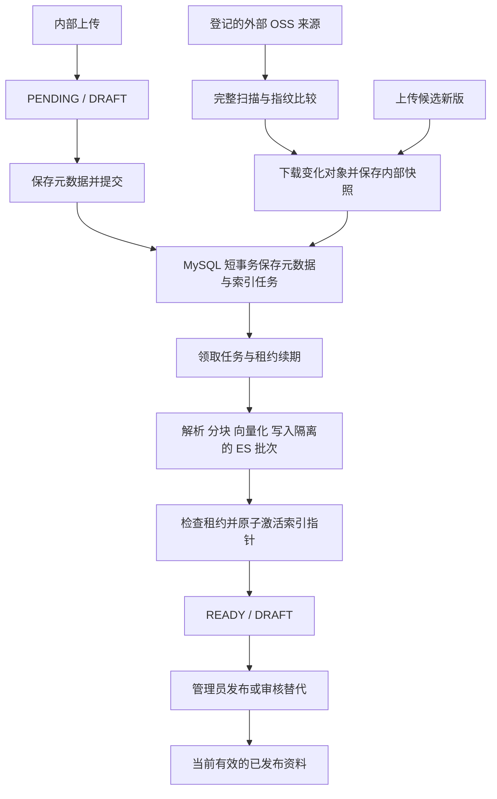
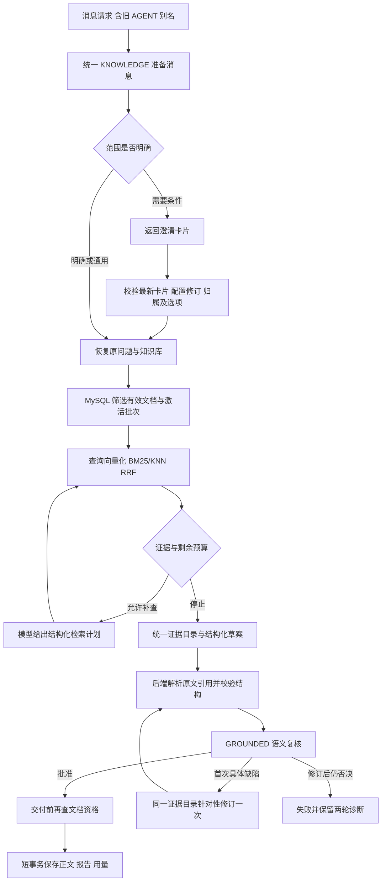

# 企业知识问答架构

阶段 44 汇总基础架构，阶段 45 增加具体缺陷复核与一次修订。系统面向单企业知识问答：管理员维护资料，员工查询规则。它是带有限检索规划的 RAG 工作流；当前问答主链路不使用原生 Tool Calling 或 MCP。能力及验证口径以[交付清单](../项目交付清单.md)为准。

## 组件职责

| 组件 | 保存或执行什么 | 不能据此声称什么 |
| --- | --- | --- |
| Spring Boot / Spring AI | 鉴权、文档流程、任务执行、模型调用和回答核验 | 框架不会自动保证回答正确 |
| MySQL | 文档业务身份、版本链、发布与有效时间、任务租约、会话和诊断 | 与 ES、OSS 没有跨系统原子事务 |
| OSS | 管理端上传文件、外部来源导入后的不可变快照 | ETag 不等于文件 SHA-256；不作为业务版本权威 |
| Elasticsearch | 文本块、向量、执行批次标识；BM25/KNN 双路召回 | 索引中存在文档不代表当前可以使用 |
| 文本模型 | 主题识别、有限检索规划、结构化草案、语义复核 | 复核与生成可能相关出错 |
| Embedding 模型 | 文档块和查询向量化 | 更换不兼容模型后不能直接复用旧向量 |

实际依赖版本见 `pom.xml`。本地真实验证不等于已完成生产部署、性能容量测试或多实例故障演练。

## 资料进入与更新

**处理状态和发布状态分开。** `READY` 只代表解析和索引完成；`DRAFT` 仍不可检索。内部首次上传不会自动进入任务，必须显式提交。后台扫描任务表只领取已提交任务，不会把所有 PENDING 文件擅自索引。候选新版接口已包含提交动作。

**任务至少执行一次。** 同一事务保存元数据和任务，随后工作线程按数据库时间抢占租约。默认最多尝试三次、重试间隔 30 秒、租约 120 秒；每次领取使用新的执行令牌。ES 文档 ID 包含本次批次，完成时只有仍持有有效租约者能激活该批次并把任务置成功。旧执行者即使迟到写入 ES，也不能改变有效指针。

这解决的是“重复执行不能错误激活”，不保证只调用一次向量模型。ES 写入与 MySQL 提交之间失败可能留下不可见批次。持续续租的卡死任务也没有硬执行截止时间。任务表保留最近提交状态，不是完整任务审计流水。

**文档级增量更新。** `sourceKey + applicabilityScope` 表示业务来源，`businessVersion` 是制度版本，`version` 是数据库乐观锁版本。候选继承来源与范围，内容 SHA-256、扩展名、业务元数据和前驱共同用于重复识别。只有文件名改变不构成新版；变化文档整份重新解析与向量化，不做段落级复用。

上传候选先以短事务预留记录，再在事务外写 OSS，最后提交上传完成和索引任务。它没有把网络上传包进长事务，代价是中断可能留下 UPLOADING 记录或孤儿对象，当前没有完整自动恢复。

**审核交接。** 审核按旧版、候选的顺序加锁，并校验两份乐观锁版本。一个事务写入新旧关联及交接时间。实际资格同时满足业务有效期与启用/被替代时间，均按半开区间判断。未来生效候选不会提前挤掉旧版；取消未来安排可恢复旧版退出边界。已经生效的新版撤回后旧版不自动复活，恢复旧制度必须明确维护。

外部来源仅扫描管理员登记的同 Bucket 目录。LIST/HEAD 指纹包含 ETag、大小、修改时间和业务元数据，变化后再条件下载并计算内容 SHA。首次导入为草稿，后续变化走候选审核。完整无错误扫描才标记缺失，外部删除不自动撤回。来源端维护正文与业务元数据，知识库维护审核发布；没有双向编辑、跨轮询中间版本保全或跨页事务快照。

## 一次问答

图中为正常有证据路径。无证据可直接返回 `NO_MATCH` 对应的不足结果；协议、调用、引用或复核失败走技术错误路径，不冒充正确业务拒答。

1. 新请求统一 `KNOWLEDGE`，旧客户端的 `AGENT` 只是别名。历史 AGENT 消息保留原样，不补造核验报告，也不重放旧工具输出供新答案生成。
2. 范围最多三个，可显式传数组。未指定时 ALL 只代表通用资料。按配置的完整范围名称识别明显地区；需要条件时模型选择主题，后端给选项。续答绑定最新卡片、知识库和配置修订，恢复原问题重新查证。没有任意代词追问的长期记忆。
3. MySQL 准入包含 READY、PUBLISHED、业务版本、有效时间、交接时间及范围。多范围初检同时包含选中范围与 ALL，使用一次查询向量化。BM25/KNN 各自排序，RRF 用 `1/(60+rank)` 融合。没有训练重排模型。
4. 首轮、缺地区补查和模型规划共享预算：最多三轮、五次逻辑搜索、两次规划；累计最多 50 块和 50,000 字符。90 秒是补查调度软预算，不是整次请求的硬超时。一次逻辑混合搜索可有两路 ES 查询，不能把它说成只有一次物理 I/O。
5. 当前采用原有有界规划器，`task-planning-enabled=false`；候选方案没有通过冲突题门槛。模型只输出查询计划，实际调用、去重、预算、资格检查和停止由 Java 执行。不会为每个地区分别生成及复核答案。
6. 模型选择本轮证据段落，后端抽取原文；目录身份、引用和结构校验保证出处，不保证推论正确。默认 GROUNDED 语义复核围绕实际问题、必要条件和历史阶段给出具体缺陷。首次具体否决可修订一次，再执行相同引用、结构、范围及语义核验；末次仍否决则失败。修订意见不是事实来源，部分可答与冲突展示仍须复核通过。交付前继续复查资格。不同地区金额不同不天然构成冲突；只检查被召回资料，无法证明全库无冲突。
7. SSE 在核验、落库后才交付一次完整正文 delta，再 done。失败为 error。取消后迟到结果不能覆盖状态，但不能保证厂商停止计费。

业务结果分可回答、需澄清、证据不足和冲突。语义复核否决属于技术失败，不能算“正确拒答”。诊断独立短事务尽力落库，可能不完整；记录各阶段耗时、调用用量和输入输出，不宣称观测记录与消息强原子提交。

## 一致性与安全边界

| 边界 | 当前保证 | 仍有的限制 |
| --- | --- | --- |
| MySQL ↔ ES | 激活批次隔离、查询及交付复查资格 | 无分布式事务、无覆盖生成全过程的全局快照 |
| 任务并发 | 租约 + 执行令牌阻止过期任务激活 | 会重复计算；真实双实例崩溃恢复未演练 |
| OSS ↔ MySQL | 独立不可变候选，旧版不被覆盖 | 上传中断与孤儿清理有限 |
| 对话并发 | 生成中冲突控制、短事务、取消状态保护 | 外部模型请求可能仍在运行 |
| 权限 | 管理员维护、客户只访问自己的会话 | scope 是制度范围，不是文档 ACL；默认库全局共享 |
| 回答可信 | 过滤、引用、复核、诊断 | 会漏冲突、误拒或漏检；没有“零幻觉”保证 |

表结构及枚举见[数据库字典](../database-schema.md)。实现入口与动手验证见[代码阅读顺序](../interview/代码阅读与动手练习.md)。
